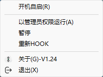
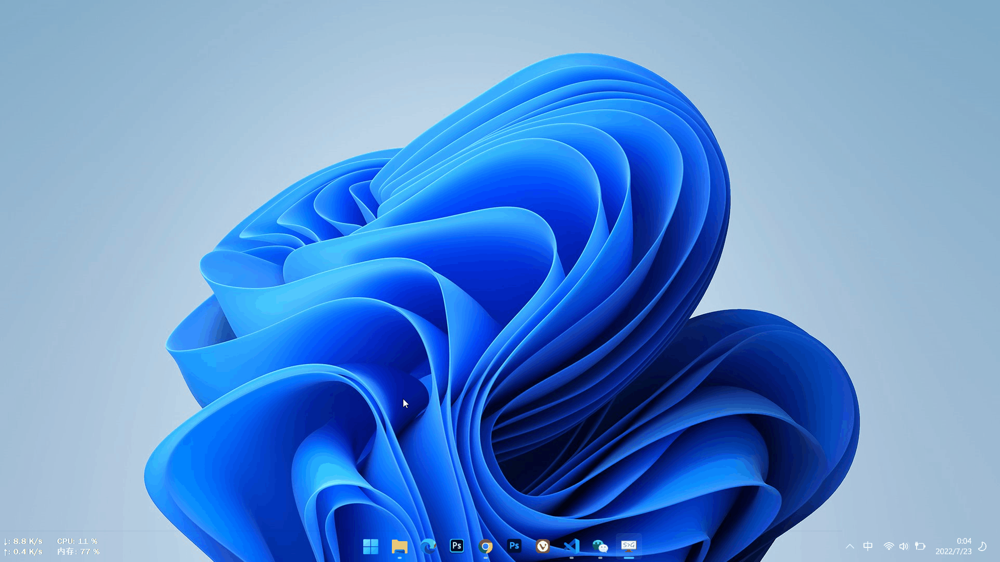

# ScrollSound 简介
[](https://996.icu/#/en_US)
[](https://github.com/996icu/996.ICU/blob/master/LICENSE)
[](https://github.com/SWDaby/ScrollSound/releases/latest)
<br>

**ScrollSound**是一个可以让你在任务栏空白处用滚轮控制音量的小工具。一个看似鸡肋用了却离不开的小功能。<br>
目前支持win10、win11。<br>


## ✨相关链接：
**下载：**<br>
[Github](https://github.com/SWDaby/ScrollSound/releases/latest)<br>
[Gitee](https://gitee.com/swdaby/ScrollSound/releases/)<br>
[阿里云盘](https://www.aliyundrive.com/s/TBGXFokBRB3) 提取码：`bg1m`<br>

**构建：**<br>
Rust 移植版。需要 [Rust](https://www.rust-lang.org/) 工具链，构建命令：<br>
```
cargo build --release
```
产物在 `target\release\ScrollSound.exe`<br>

**调试：**`ScrollSound.exe --debug` 会在 exe 同目录生成 `scrollsound.log` 日志。


原 C++ 版本参考了 TrafficMonitor 项目里的一些类，点击围观[大佬](https://github.com/zhongyang219/TrafficMonitor)（本次 Rust 移植从零重写，不再包含其代码）<br>

本项目[图标资源](https://www.flaticon.com/)<br>

## ✨使用

双击打开，将鼠标移至任务栏空白处，滚动滚轮或按下滚轮即可调节音量大小或静音。

为什么要用？为了优雅。

## 截图

托盘菜单：

<div align=center></div>




<div align=center></div>

